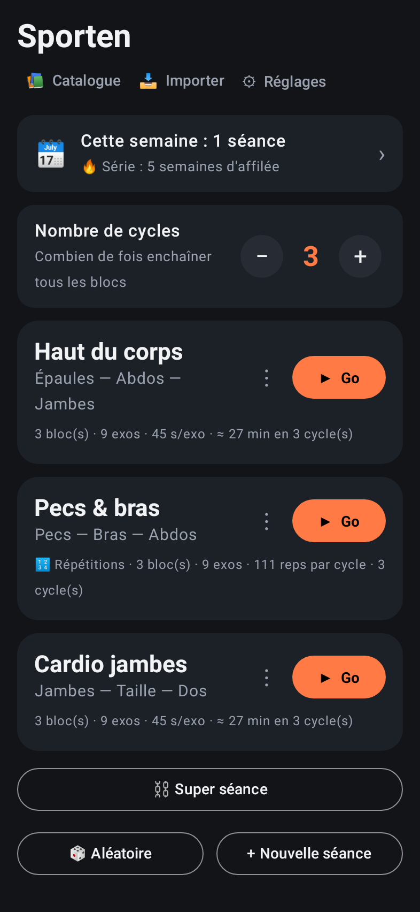
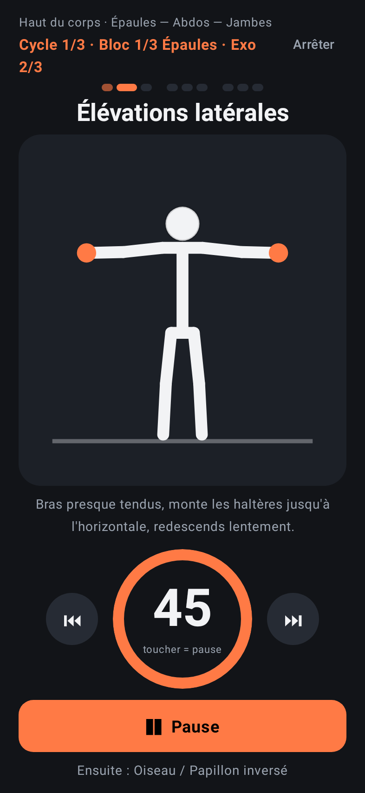
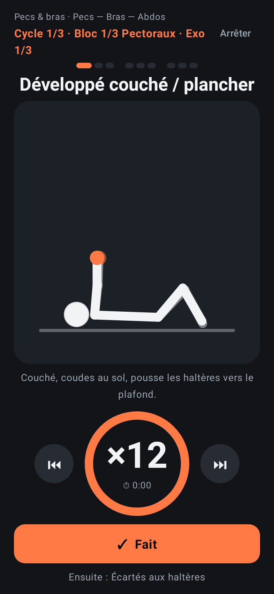
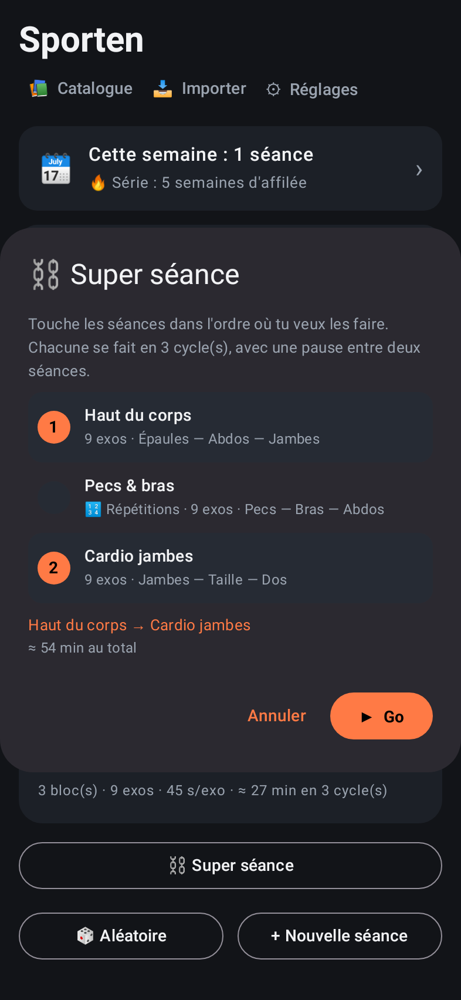
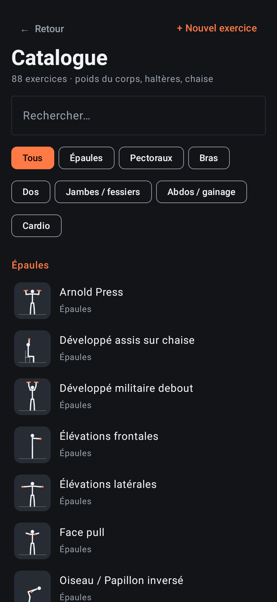
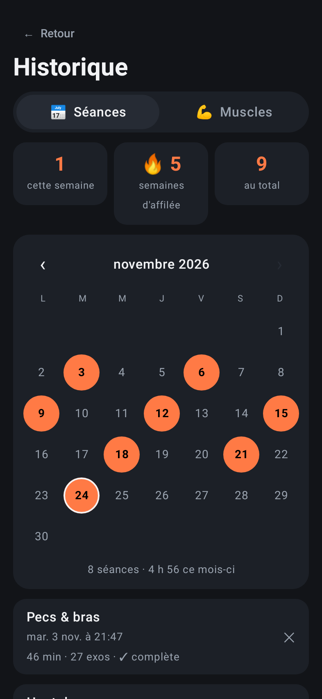

# Sporten

App Android de séances de sport en circuit : exercices animés, chrono ou répétitions, cycles, repos,
annonces vocales, historique et partage de séances par QR code. Sans compte, sans pub, tout reste sur le téléphone.

<p align="center">
  
  
  
</p>

## Ce que fait l'app

- **Séances en circuit** : des blocs d'exercices enchaînés, répétés sur plusieurs cycles, avec préparation,
  transitions entre exercices et repos entre cycles.
- **Deux types de séance** :
  - **⏱ Chrono** : max de répétitions pendant un temps donné, le chrono passe tout seul à l'exercice suivant ;
  - **🔢 Répétitions** : un nombre de reps par exercice, on touche **✓ Fait** pour passer à la suite.
- **Super séance** : enchaîne plusieurs séances à la suite (par exemple la séance 1 puis la séance 2),
  avec une pause entre les deux.
- **Catalogue** de près de 90 exercices animés (poids du corps, haltères, chaise, salle), par groupe musculaire,
  et exercices perso.
- **Séance aléatoire** à partir des groupes musculaires choisis.
- **Partage** d'une séance par QR code ou code texte, import en le scannant ou en le collant.
- **Historique** : calendrier, séries de semaines, records, muscles travaillés, et résumé à copier dans Strava.
- Annonces vocales, écran toujours allumé, chrono qui continue écran éteint, plusieurs thèmes de couleurs.

<p align="center">
  
  
  
</p>

## Installer

1. Sur le téléphone Android (8.0 ou plus récent), ouvre la page
   [**Releases**](https://github.com/Elweyy/sporten/releases/latest) et télécharge le fichier `Sporten-x.y.apk`.
2. Ouvre le fichier téléchargé. Android demande d'autoriser ton navigateur (ou ton gestionnaire de
   fichiers) à installer des applis : accepte, puis touche **Installer**.

## Mises à jour

Au lancement, Sporten regarde s'il y a une nouvelle release ici. Si oui, un bandeau « Nouvelle version »
apparaît sur l'accueil : **Mettre à jour** télécharge la version et ouvre l'installateur d'Android.
La première fois, Android demande d'autoriser Sporten à installer des applis.
Tes séances, tes exercices perso et ton historique sont gardés, et une fenêtre « Quoi de neuf » présente
les nouveautés.

L'app ne se connecte à internet que pour cette vérification (lecture des releases de ce dépôt),
elle n'envoie aucune donnée.

## Compiler l'app

Kotlin et Jetpack Compose. Il faut un JDK 17 et le SDK Android (API 35).

```sh
./gradlew assembleDebug        # APK de développement : app/build/outputs/apk/debug/app-debug.apk
./gradlew testDebugUnitTest    # tests unitaires
```

Les captures ci-dessus sont dessinées par les tests, sans téléphone (Robolectric + Roborazzi) :

```sh
./gradlew testDebugUnitTest -Pscreenshots    # régénère docs/screenshots
```

Une version de développement n'a pas de mises à jour automatiques : elle n'est pas signée avec la clé
des releases, Android refuserait de la remplacer par une release (et inversement).

### Releases

`./gradlew assembleRelease` signe l'APK avec la clé décrite dans `~/.config/sporten/signing.properties`
(hors du dépôt) :

```properties
storeFile=sporten-release.jks
storePassword=…
keyAlias=sporten
keyPassword=…
```

Les notes de chaque version sont dans `app/src/main/assets/release-notes/<version>.md` : elles servent
à la release GitHub, au bandeau de mise à jour et à la fenêtre « Quoi de neuf ».

### Organisation du code

| Dossier | Contenu |
| --- | --- |
| `app/src/main/java/fr/loic/seances/data` | Modèle, catalogue d'exercices, bibliothèque (JSON), historique, codes de partage |
| `app/src/main/java/fr/loic/seances/session` | Déroulé d'une séance (étapes, chrono, annonces vocales, résumé) et service au premier plan |
| `app/src/main/java/fr/loic/seances/anim` | Bonhomme animé et animations des exercices |
| `app/src/main/java/fr/loic/seances/ui` | Écrans Compose et thèmes |
| `app/src/main/java/fr/loic/seances/update` | Mises à jour depuis les releases GitHub, « Quoi de neuf » |
| `app/src/test` | Tests unitaires et captures d'écran |
